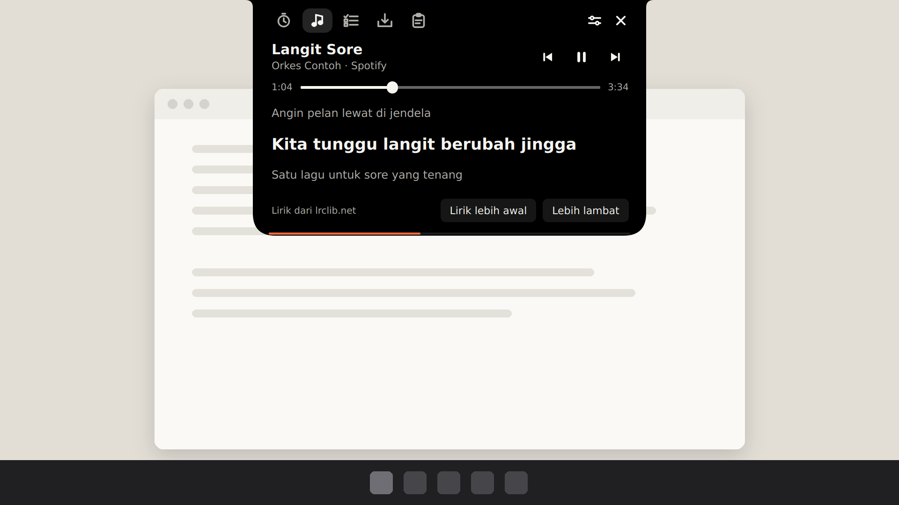
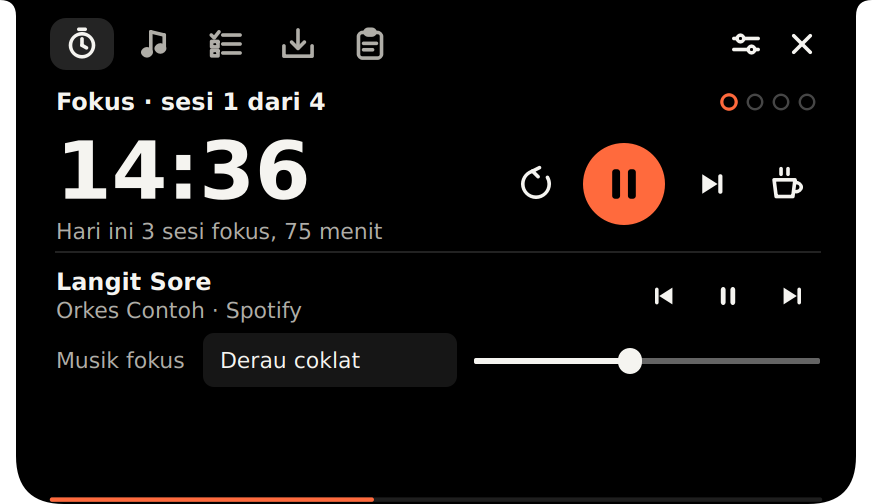
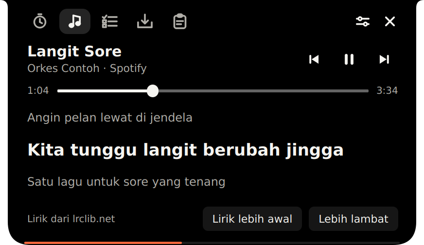
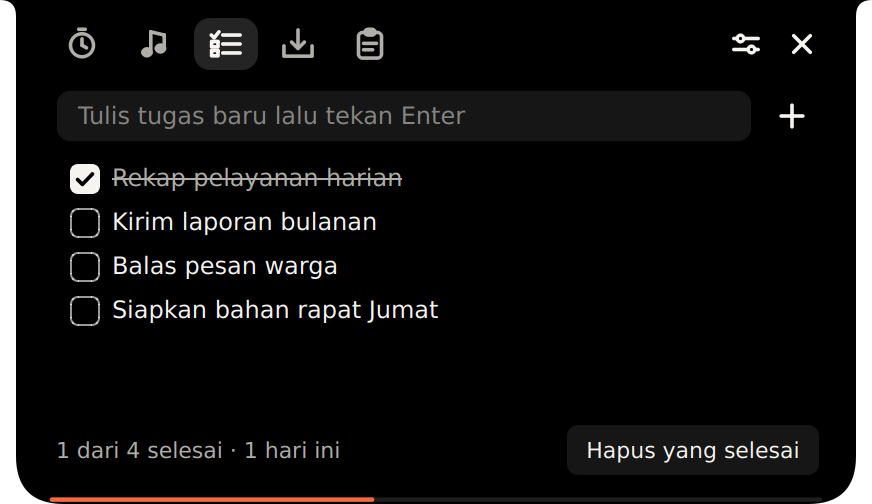
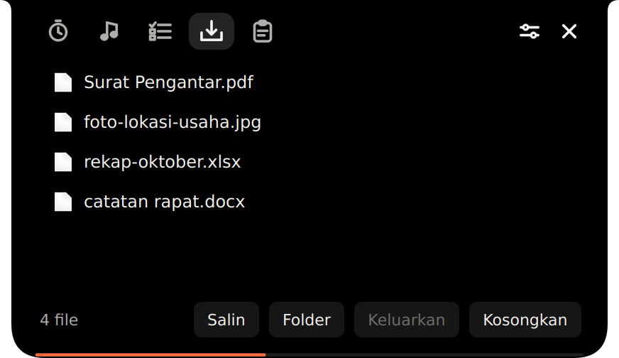
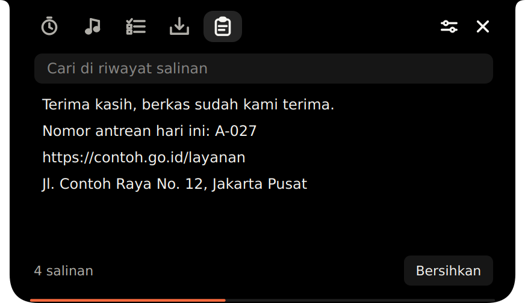
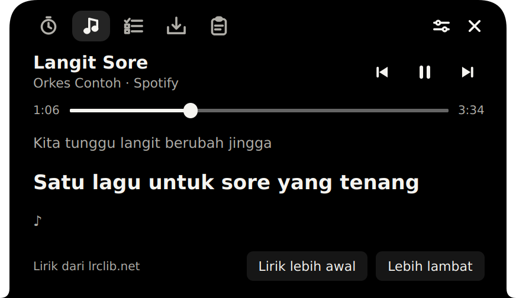

# Pulo

Pulau fokus di tepi layar Windows. Pil hitam kecil yang menempel di tengah atas layar seperti notch, lalu membesar saat kursor mendekat: timer Pomodoro, kontrol musik dengan lirik berjalan, daftar tugas, rak berkas, dan riwayat salinan.

*Pulo* artinya pulau dalam bahasa Betawi.




## Fitur

| | |
|---|---|
|  | **Fokus.** Timer Pomodoro (fokus, rehat sebentar, rehat panjang), tombol rehat ngopi, catatan sesi hari ini, dan musik fokus: derau coklat, derau pink, atau lagu dari folder sendiri. |
|  | **Musik & lirik.** Judul lagu dari Spotify, YouTube di browser, atau pemutar lain. Putar/jeda, lanjut, mundur, geser posisi lagu, dan lirik yang berjalan mengikuti lagu (dari lrclib.net). |
|  | **Daftar tugas.** Tulis lalu Enter, centang kalau selesai, klik dua kali untuk mengubah. Tersimpan otomatis. |
|  | **Rak berkas.** Seret file ke pulau untuk dititipkan, lalu seret lagi ke WhatsApp, email, atau folder lain. |
|  | **Riwayat salinan.** Teks yang kamu salin bisa dicari dan disalin lagi dengan sekali klik. |

Lainnya:

- Pil kecil menunjukkan sisa waktu dan garis progres. Kalau timer dimatikan, pil menampilkan baris lirik yang sedang dinyanyikan.

   

- Bisa diletakkan di atas atau bawah layar (di atas taskbar), dan digeser ke kiri atau kanan.

  

- Sembunyi otomatis saat ada aplikasi layar penuh (film, game, presentasi).
- Ikon di tray, pintasan keyboard, dan opsi jalan saat Windows menyala.

## Menjalankan

Butuh Windows 10 atau 11 dan **Python 3.11 sampai 3.13** dari [python.org](https://www.python.org/downloads/). Saat memasang Python, centang *Add python.exe to PATH*. Python 3.15 belum didukung paket pembaca judul lagu.

| File | Fungsi |
|---|---|
| `jalankan.bat` | Memasang paket (sekali saja) lalu menjalankan Pulo |
| `buat-exe.bat` | Membuat `dist\Pulo.exe` beserta shortcut di Desktop dan Start Menu |
| `buat-shortcut.bat` | Membuat ulang shortcut, misalnya setelah folder dipindah |

`Pulo.exe` bisa dipakai di komputer lain tanpa memasang Python.

## Pintasan

| Tombol | Fungsi |
|---|---|
| `Ctrl+Alt+Spasi` | Mulai / jeda timer (putar / jeda musik kalau timer dimatikan) |
| `Ctrl+Alt+P` | Buka pulau dan pindah ke keyboard |
| `Esc` | Tutup panel |
| Seret pil | Geser ke kiri atau kanan; klik dua kali panel untuk kembali ke tengah |

## Privasi

- **Lirik** dicari di [lrclib.net](https://lrclib.net) dengan mengirim judul dan nama penyanyi. Bisa dimatikan di Pengaturan.
- **Riwayat salinan** hanya disimpan di memori selama Pulo berjalan dan tidak pernah ditulis ke disk. Bisa dimatikan di Pengaturan.
- **Rak berkas** hanya menyimpan alamat file; file aslinya tidak disalin atau dipindah.
- Pengaturan, daftar tugas, dan isi rak tersimpan di `%APPDATA%\Pulo\pengaturan.json`.

## Struktur

```
pulo.py                  aplikasi (PySide6)
requirements.txt         paket wajib
requirements-musik.txt   paket pembaca judul lagu (opsional)
jalankan.bat             jalankan dari sumber
buat-exe.bat             rakit Pulo.exe + shortcut
buat-shortcut.bat/.ps1   buat shortcut Desktop dan Start Menu
pulo.ico                 ikon aplikasi
LICENSE                  lisensi MIT
docs/preview/            gambar untuk README
```

## Terinspirasi dari

[NotchFlow](https://notchflow.app) untuk Mac dan Notch Island untuk Windows. Pulo ditulis ulang dari nol dengan Python dan tidak memakai kode atau aset dari keduanya.

## Lisensi

[MIT](LICENSE). Boleh dipakai, diubah, dan dibagikan, termasuk untuk keperluan komersial, asal tetap mencantumkan file lisensi ini.
